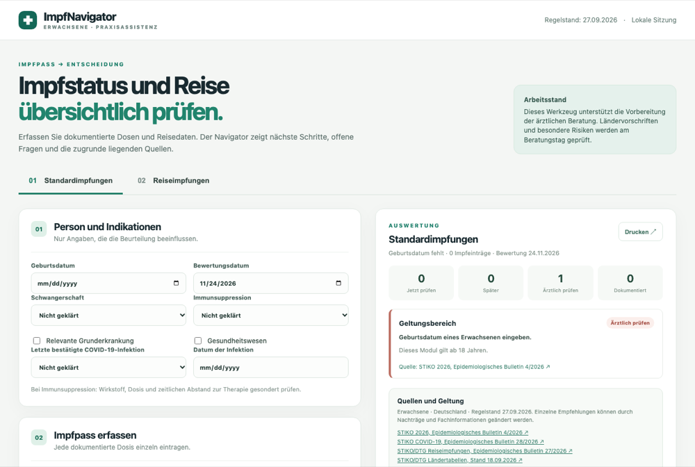

# ImpfNavigator

> **Unvalidated personal prototype. Not in clinical use, not distributed, not a medical device.**

A local prototype that organises an adult's documented vaccinations and travel plans before a vaccination
consultation in a German general practice. The interface is in German.

  

## What it explores

- **Standard vaccinations for adults** (Td/Tdap, IPV, MMR, MenACWY, PCV, RZV, influenza, COVID-19, RSV), based on
  selected STIKO rules, with open questions left open rather than guessed.
- **Vaccination record:** individual documented doses, with plausibility checks such as duplicate entries
  and intervals that are too short.
- **Travel:** several destinations in order, with *review notes* for some countries. These are prompts for the
  physician to check, not confirmed recommendations or entry rules.
- **A source link for every result**, and a printable summary.

It runs entirely in the browser. Nothing is stored or sent anywhere.

## Why

I'm a physician in general-practice training. This is a spare-time experiment in how decision support for a
vaccination consultation could be laid out clearly, and where it has to stop and leave the decision to the doctor.

This repository is a showcase. The source code is not public.

Made by [Sepehr](https://sepehr.digital).
